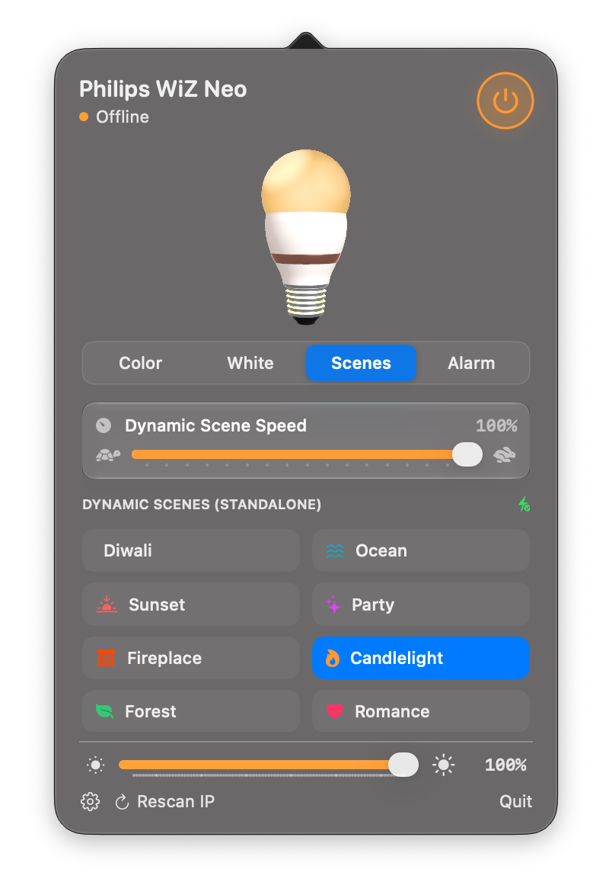
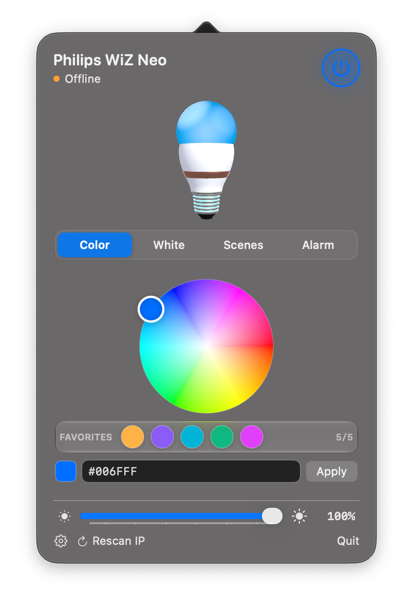

# Lumina WiZ

A small, native macOS menu bar controller for WiZ smart bulbs. Lumina talks directly to the bulb over your local network, with no account, cloud service, or third-party package dependencies.

## Screenshots

| Color controls | Scenes and alarms |
| --- | --- |
|  |  |

## Features

- Turn the bulb on or off from the menu bar popover. Right-click or Option-click the menu bar icon to toggle power quickly.
- Adjust brightness, choose a color from the wheel, save up to 5 favorite colors, enter custom hex, or set white color temperature with a tactile glide slider.
- Built-in WiZ standalone scenes (Diwali, Ocean, Sunset, Party, Fireplace, etc.) with real-time dynamic animation speed controls.
- Scheduled alarms and wake-up lighting with customizable actions (WiZ Hardware Alarm effect, Flashing Strobe, or Designated Color) and in-place alarm editing.
- Native Apple Liquid Glass aesthetic and popover interface with fluid spring motion.

## Requirements

- macOS 13 or later
- Apple Command Line Tools with the macOS SDK and Swift compiler
- A WiZ bulb reachable from the Mac on the local network

Full Xcode is not required to build the app when the Command Line Tools and macOS SDK are installed.

## Build and Run

```sh
# Build production app bundle
./build.sh

# Run unit tests
./build.sh --test

# Run headless verification
./build.sh --selftest

# Build isolated developer variant side-by-side with production
./build.sh --dev

# Install to /Applications
./build.sh --install

# Package a compressed DMG installer for local installation
./Tools/make-dmg.sh
```

> [!NOTE]
> The packaged disk image is ad-hoc signed for local and manual installation (not Apple-notarized). On first launch on a new Mac, macOS Gatekeeper may request approval. You can launch it by **Right-Clicking > Open**, or via **System Settings > Privacy & Security > Open Anyway**.

## Connect to a Bulb

1. Connect the Mac and bulb to the same local network. Guest Wi-Fi and client isolation can block communication between devices.
2. Open Lumina from the menu bar and choose the gear icon.
3. Enter the bulb's IP address, then save.
4. In the WiZ app, enable **Allow all controls** under **Settings → Security**.

Lumina sends unsigned local UDP commands to port `38899`. Bulbs configured to require verified controls are not supported by this version. If a command is rejected, check the WiZ security setting and the IP address shown in Lumina.

## Project Architecture

- `Sources/`
  - `App/` — [`AppDelegate.swift`](Sources/App/AppDelegate.swift), [`StatusItemController.swift`](Sources/App/StatusItemController.swift)
  - `Core/` — [`Defaults.swift`](Sources/Core/Defaults.swift), [`WizModels.swift`](Sources/Core/WizModels.swift)
  - `Services/` — [`WizService.swift`](Sources/Services/WizService.swift), [`ScheduleManager.swift`](Sources/Services/ScheduleManager.swift)
  - `Support/` — [`SelfTest.swift`](Sources/Support/SelfTest.swift)
  - `UI/` — [`MainView.swift`](Sources/UI/MainView.swift), [`Sections/`](Sources/UI/Sections), [`Components/`](Sources/UI/Components)
- `Tests/` — Standalone test runner and test cases for UDP commands, color conversions, and schedules
- `Tools/` — [`make-dmg.sh`](Tools/make-dmg.sh) packaging script

## Privacy and Affiliation

Lumina controls bulbs on your local network and does not send bulb data to a cloud service. This is an independent community project and is not affiliated with or endorsed by Signify, Philips, or WiZ. Bulb features and local control behavior may vary by model, firmware, and security settings.
